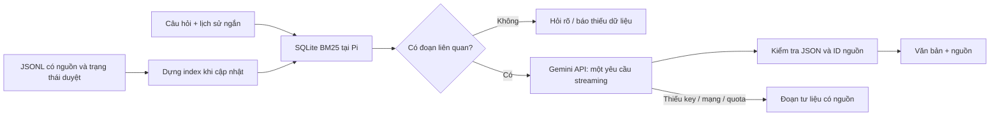

# Kế hoạch chatbot Cơ Tu trên Raspberry Pi 5 — thử nghiệm Gemini API

**Bản app cài trên Pi:** xem [Triển khai app và cập nhật theo phiên bản](TRIEN_KHAI_APP_PI5.md).
App mở bằng biểu tượng, chạy bản phát hành riêng; sửa mã nguồn hằng ngày chỉ
đi vào app sau thao tác đóng gói và cập nhật.

Cập nhật 18/10/2026. Ưu tiên **giao diện mượt, nhẹ RAM, thử nghiệm trước** trên Pi 5 RAM 4 GB đang chạy video/RFID. Kế hoạch local trước đây được giữ ở [bản tham khảo](research/KE_HOACH_CHATBOT_LOCAL_THAM_KHAO.md), không còn là cấu hình mặc định.

## 1. Quyết định triển khai

**Pi: Python tiêu chuẩn + SQLite FTS5/BM25 → Gemini API HTTPS streaming → câu trả lời có nguồn.** Chưa nạp embedding, LLM, Torch hoặc vector DB lên Pi. Lựa chọn này giảm thành phần thường trực và cần đo thực tế, chưa phải kết luận nhanh nhất với mọi corpus.

Model mặc định: `gemini-3.1-flash-lite`, thinking `minimal`. Model được chọn theo bảng quota AI Studio người dùng cung cấp: 15 RPM, 250.000 TPM, 500 RPD tại thời điểm ảnh chụp; quota thực tế có thể thay đổi. Google công bố Free Tier cho input/output của model này. Đổi model qua `GEMINI_MODEL`, không tự chuyển model khi hết quota. [Model](https://ai.google.dev/gemini-api/docs/models/gemini-3.1-flash-lite), [giá](https://ai.google.dev/gemini-api/docs/pricing), [vòng đời](https://ai.google.dev/gemini-api/docs/deprecations), [thinking](https://ai.google.dev/gemini-api/docs/thinking).

Free Tier phụ thuộc project/tài khoản/khu vực và RPM/TPM/RPD thực tế trong AI Studio, không có một số lượt miễn phí chung được bảo đảm. Dùng project Free Tier, chưa bật billing cho thử nghiệm. Mã nguồn không kiểm chứng được billing: key của project trả phí vẫn có thể phát sinh phí. Không bật Google Search, Files API hoặc công cụ khác. [Quota](https://ai.google.dev/gemini-api/docs/rate-limits).



## 2. Dữ liệu và tính đúng đắn

Giữ raw, manifest, hash và [hồ sơ nguồn](research/NGUON_CO_TU.md). Toàn bộ `data/chatbot/clean/documents.jsonl` hiện **chưa có `production_approved=true`**. Không tự duyệt để demo chạy được. `data/chatbot/corpus/` có bản sao JSONL giữ nguyên provenance và lệnh nhập lại khi dữ liệu thay đổi.

- `approved` (mặc định): chỉ nhận `production_approved=true`, `review_status=approved`; loại các mục cách ly, ngữ cảnh và đăng lại.
- `research` (chọn rõ khi thử): chỉ thêm `usage=research_notes`, `review_status=agent_reviewed`; kết quả gắn **thử nghiệm, chưa duyệt**. Không nhận mẫu S01 cách ly, S10 khác tộc người hoặc nguồn đăng lại S11.

Không huấn luyện từ năm đáp án, không ghép các dị bản nguồn gốc, không tự định danh khoa học chim Tring. Nguồn hiện là tóm lược biên tập có locator, chưa phải toàn văn truyện. Mỗi ghi chú ngắn là một đoạn; mục quá dài phải chia theo cấu trúc, giữ locator trước khi nhập. Chưa dùng tokenizer hoặc semantic search.

Cập nhật corpus: đối chiếu raw/hash → duyệt nội dung/quyền dùng → nhập JSONL → dựng index đúng chính sách → chạy đánh giá. Câu hỏi và đoạn chọn sẽ gửi đến Google. Free Tier có thể dùng input/output để cải tiến sản phẩm và có người đánh giá; chỉ thử với nội dung công khai được phép dùng, không nhập dữ liệu riêng tư. [Điều khoản dữ liệu](https://ai.google.dev/gemini-api/terms).

## 3. Cách làm mượt

| Hạng mục | Thực hiện |
|---|---|
| UI | Tkinter, API ở worker; queue cập nhật chữ khoảng 40 ms/lần |
| Retrieval | FTS5/BM25, chuẩn hóa dấu/đ, bỏ từ phổ biến, bảng cách gọi gươl/nói lý; tối đa 3 đoạn |
| Prompt | Dẫn chứng ≤ 6.000 ký tự; tối đa 2 lượt gần nhất; output ≤ 512 token |
| Đồng thời | Một lượt hỏi, nút Dừng; không xếp hàng nhiều lượt hoặc retry nền |
| Cache | LRU RAM 64 câu, TTL 15 phút; khóa gồm prompt/lịch sử/model/cấu hình/phiên bản index |
| Mạng/quota | Timeout, cooldown 429 theo Retry-After; không tự chuyển model trả phí |
| Offline | Hiện **đoạn tư liệu liên quan**, không gọi đó là câu trả lời Gemini |
| Khởi động | Mở index đã có; không OCR/tải model/dựng index trong lượt hỏi |
| Video/RFID | Đã ghép ChatPanel vào cùng cửa sổ qua service dùng chung; đo toàn chuỗi tiếp |

BM25 không hiểu mọi cách diễn đạt như embedding; alias chỉ bổ sung một số thuật ngữ, cần thêm theo lỗi thật. Điểm retrieval không phải xác suất đúng. JSON và ID hợp lệ chỉ bảo đảm cấu trúc và nguồn có trong context; vẫn cần chấm các mệnh đề có đúng dẫn chứng không.

Chữ đang stream là bản nháp; hoàn tất mới kiểm tra status/ID và thay bằng kết quả cuối. Hủy/lỗi/đáp án bị cắt không vào cache hoặc lịch sử. URL nguồn do ứng dụng ánh xạ từ corpus, không tin URL model tạo.

## 4. Module chatbot trong dự án chung

Chatbot nằm trong `src/cotu_app/features/chatbot/`, cùng package với TTS,
STT, truyện, video và phần cứng. Không còn Python project `chatbot/` riêng.
Xem [kiến trúc](ARCHITECTURE.md) và [cấu trúc gốc](../README.md).

```text
src/cotu_app/features/chatbot/  # config, retrieval, Gemini, service, CLI, desktop, integration
config/chatbot/                # aliases.json, .env.example, .env riêng tại máy
data/chatbot/                  # raw/manifests/clean/corpus/index/evaluation
tools/chatbot/                 # thu thập, chuẩn bị ghi chú, import corpus
tests/unit/chatbot/            # kiểm thử retrieval, API giả, cache/quota/hủy
reports/chatbot/               # báo cáo, không ghi key/hội thoại
docs/chatbot/                  # hướng dẫn và đánh giá
```

Lõi chatbot chỉ cần Python tiêu chuẩn và SQLite; không nạp Torch/LLM local.
`ChatPanel` nhúng vào hai cửa sổ qua `features/chatbot/integration.py`. Video
chuyển câu gõ/mic chưa khớp mẫu sang Gemini; nút Đọc trả lời dùng TTS hiện có.
Đầu ra gồm `answer_text`, `citations`, `status`, `character_id`.

## 5. Các bước và cổng kiểm tra

| Bước | Sản phẩm | Điều kiện |
|---|---|---|
| 1 | Kế hoạch + cấu trúc riêng | API-first, chính sách dữ liệu và cách chạy rõ |
| 2 | Import JSONL + SQLite | Giữ nguồn/trạng thái; approved rỗng phải báo đúng |
| 3 | Gemini streaming/fallback/cache/quota | Test transport giả; offline chạy không cần key |
| 4 | CLI + desktop | API ngoài luồng UI; hủy/phiên mới bỏ kết quả cũ |
| 5 | Đo tại Pi | Retrieval/RAM/Recall seed, tách kết quả offline và API |
| 6 | Thử API thật | Cần key Free Tier; đo quota, chất lượng, TTFT và p95 |
| 7 | Nối video/RFID | Đã có tab chung, đồng bộ nhân vật/hủy; tiếp tục chấm groundedness/dị bản và chạy video lâu dài |
| 8 | Mic/TTS | Đã nối câu mic qua ô hỏi hiện có, Đọc trả lời qua TTS; tiếp tục đo lỗi STT và RAM tổng |

Mục tiêu cần đo: retrieval warm p95 ≤ 100 ms; app văn bản thêm ≤ 150 MiB RSS với corpus nhỏ; token đầu API p95 ≤ 3 giây, hoàn tất p95 ≤ 8 giây nếu mạng/quota cho phép. Dùng ≥ 100 lượt offline cho p95; **không tự bắn 100 lượt API free**, thu thập dần sau khi kiểm tra quota.

Recall@3 chỉ tính trên seed có đáp án và báo mẫu số/lỗi. Seed chưa phải gold; alias có thể thiên lệch theo seed. Chấm riêng thiếu dữ liệu/phủ định/khác tộc người/dị bản/prompt injection/follow-up. Recall không thay groundedness. Chạy cùng video 30 phút mới kết luận độ mượt tổng thể. Không suy SLA từ test giả.

## 6. Chạy bản đầu

```bash
cd /home/admin/NhaRongCoTu
./run_chatbot.sh doctor
./run_chatbot.sh build-index --mode research
./run_chatbot.sh ask --mode research --offline "Gươl dùng để làm gì?"
./run_chatbot.sh evaluate --mode research
# Thiết lập GEMINI_API_KEY tại máy theo README rồi mở cửa sổ:
./run_chatbot.sh desktop --mode research
```

Chạy trong dự án chính với giao diện đã tích hợp: `./run_video.sh --chatbot`
hoặc `./run_rfid.sh --chatbot`. Cấu hình `config/video_stories.json` bật chatbot ở
mode research cho thử nghiệm, giữ nguyên cảnh báo/chính sách duyệt corpus.

Xem [README](chatbot/README.md) và [báo cáo kiểm chứng](../reports/chatbot/VALIDATION.md). Đã cấu hình key riêng tại config/chatbot/.env theo yêu cầu, không ghi key vào tài liệu. Đã kiểm tra giao diện và bàn phím 800×480 trên desktop Pi; đã gọi Gemini 3.1 Flash-Lite qua khung chat tích hợp trong VideoApp, trả lời có nguồn thành công khoảng 8,4 giây. Đây chưa phải p95, kiểm tra mic/loa thực hoặc đánh giá chất lượng đầy đủ.
