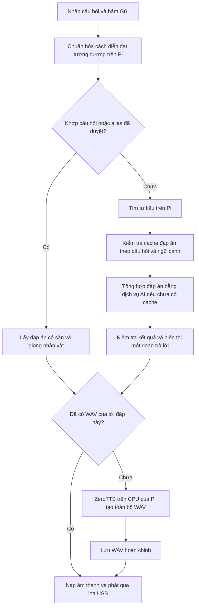

# Luồng hỏi đáp và giọng đọc Nhà Gươi 1.1.7

## Khi gửi một câu hỏi



AI tổng hợp câu trả lời và ZeroTTS là hai công việc riêng. AI tạo **chữ** qua
mạng; ZeroTTS chuyển chữ đó thành **âm thanh** ngay trên Pi. Không phải có
đáp án trên màn hình là âm thanh đã sẵn sàng.

1. `ChatPanel.send()` nhận câu hỏi, chạy công việc nền để giao diện không bị đơ.
2. Từ **1.1.6**, `ChatService.ask()` tra bộ hỏi đáp trước. Có khớp thì lấy
   đáp án đã duyệt ngay, không tìm SQLite hoặc gọi AI, kể cả khi mất mạng,
   chưa có API key hoặc AI đang hết hạn mức. Câu chưa khớp mới tìm SQLite,
   đưa câu hỏi, ngữ cảnh và tư liệu vào yêu cầu AI. Cache đáp án AI phụ thuộc
   cả lịch sử hội thoại; đáp án mẫu không phụ thuộc cache này.
3. Sau khi kết quả hoàn tất, app kiểm tra cấu trúc và ID tư liệu nội bộ, làm
   gọn câu trả lời rồi hiển thị chữ. Nguồn không hiện ra cho khách.
4. App gửi lời đáp và giọng nhân vật sang tiến trình TTS riêng. Với đáp án
   mẫu, giữ nguyên chữ của bộ hỏi đáp và giọng người sở hữu câu hỏi để dùng
   lại đúng WAV đã chuẩn bị trong Hỏi đáp. Nếu chưa có
   WAV phù hợp, ZeroTTS chuẩn hóa tiếng Việt, tạo các phần sóng âm, ghép lại,
   điều chỉnh nhịp đọc và lưu WAV hoàn chỉnh.
5. App nạp và chuẩn hóa toàn bộ WAV trong RAM rồi mở loa USB. Từ thời điểm
   này loa nhận âm thanh đã sẵn sàng, không chờ model tạo từng mẩu nữa.

## Hơn 20 giây nằm ở đâu?

### Đáp án mẫu từ bản 1.1.6

[Phép đo trên bản cài 1.1.6](../../reports/tts/curated-chat.json) kiểm tra
233 cách hỏi trên sáu nhân vật (1.398 lượt tra), đủ 37/37 WAV hợp lệ. Không
có lượt tìm evidence, gọi API hoặc nạp model TTS trong phép thử. Với câu
**“Nhà Gươl là gì?”**, từ `ChatPanel.submit_question()` đến lần ghi mẫu
âm thanh đầu ra USB là **0,251 giây**; phát hoàn tất, **0 underflow**.
Đây là phép thử dùng mã bản cài, ChatPanel và AudioWorker với loa thật;
không tính thời gian mở app, IPC của SpeechService hoặc độ trễ loa sau khi
PortAudio nhận mẫu, và không đại diện cho câu trả lời AI chưa có WAV.

Luồng phát chỉ nạp SciPy nếu thiết bị cần đổi tần số. WAV hiện có và loa
USB cùng dùng 48 kHz nên không cần bước đó. Lần đo trước khi bỏ import
thừa tốn 4,885 giây ở lượt đầu; số đo này còn chịu ảnh hưởng cache hệ điều
hành, không coi chênh lệch giữa hai lượt là mức tăng tốc bảo đảm mọi lần.

### Câu trả lời mới chưa có WAV

Theo [phép đo bản 1.1.5](../../reports/tts/chat-fluency.json), với một đoạn
thử cố định, giọng Già làng, model đã nạp và chưa có WAV của đoạn đó:

| Công việc | Số đo / giới hạn của phép đo |
|---|---|
| Tổng hợp câu trả lời bằng AI qua mạng | Không được đo trong phép thử TTS này |
| Từ yêu cầu TTS chưa có cache đến lần ghi âm thanh đầu ra USB | 20,765 giây |
| Độ dài âm thanh được tạo | 7,818 giây |
| Thời gian phát thực đo được | 7,771 giây |
| Số lần thiếu dữ liệu ở đầu ra USB | 0 |
| Nạp và làm nóng model trước phép thử | 55,535 giây; tách riêng khỏi 20,765 giây |

Khoảng 20,8 giây là **riêng khâu chuẩn bị và bắt đầu phát giọng**, chưa tính
dịch vụ AI trả lời. Nó không phải phép đo tổng từ bấm Gửi đến nghe tiếng của
một câu hỏi thực. Tốc độ tạo giọng trong phép thử chỉ đạt khoảng 7,8 / 20,8
= **0,38 giây âm thanh cho mỗi giây xử lý**. Tính theo hệ số thời gian thực,
app mất khoảng **2,7 giây xử lý để tạo 1 giây lời nói**.

Với câu trả lời AI chưa có sẵn và model đã sẵn sàng, thời gian từ hỏi đến
nghe tiếng xấp xỉ:

```text
Tìm tư liệu + chờ đáp án AI + tạo giọng nếu chưa có WAV + mở loa
```

Model được nạp nền từ lúc mở app và giữ trong RAM. Bước nạp không lặp lại
mỗi câu, nhưng câu hỏi gửi quá sớm sau khi mở app vẫn có thể phải chờ nó.
Việc nạp nền không loại bỏ chi phí suy luận cho một lời đáp mới.

## Vì sao phát sớm từng mẩu lại ngập ngừng?

Phép đo trước từng ghi nhận âm thanh đầu sau khoảng 0,75 giây, nhưng tổng
quá trình tạo âm thanh vẫn lâu hơn thời lượng lời nói. Loa phát hết mẩu vừa
nhận trong khi model còn tạo mẩu tiếp theo, dẫn đến đọc vài chữ rồi dừng.

Chỉ số bắt đầu có mẫu âm thanh đầu tiên không chứng minh giọng đọc liên
tục. Bản 1.1.5 giải quyết việc đứt quãng bằng cách chờ WAV đầy đủ; nó chưa
loại bỏ nút thắt tốc độ sinh giọng của ZeroTTS trên CPU Pi.

## Cache giúp khi nào?

- Từ **1.1.7**, Hỏi đáp và Trò chuyện cùng nhận diện một số cách diễn đạt
  tương đương bằng quy tắc tiếng Việt chạy trên Pi. Ví dụ:

  | Câu nhập | Đáp án được chọn |
  |---|---|
  | Nhà guol là cái gì? / Gươl được hiểu là gì? | Nhà Gươl là gì? |
  | Bạn có thể giải thích giúp tôi nhà Gươl là cái gì vậy ạ? | Nhà Gươl là gì? |
  | Công dụng của Gươl là gì? / Gươl được sử dụng để làm cái gì? | Người dân dùng nhà Gươl để làm gì? |
  | Chim Tring có ý nghĩa gì? | Ý nghĩa của chim Tring |
  | Mái nhà Gươl làm bằng chất liệu nào? | Mái nhà Gươl được lợp bằng gì? |

  Đây là nhận diện các mẫu ngôn ngữ cụ thể, không phải model hiểu mọi cách
  diễn đạt. Giữ nguyên chủ thể, từ phủ định, số lượng, địa điểm và chi tiết
  riêng. Không bỏ từ “cái” trong “cột cái”; không gộp “lá cây gì” thành
  câu hỏi vật liệu chung. Câu không nhận diện hoặc khớp nhiều đáp án vẫn
  qua luồng chatbot thông thường. Giữ nguyên lời đáp và giọng để dùng WAV.
  [Phép đo bản cài 1.1.7](../../reports/tts/curated-chat-paraphrases.json)
  với đúng câu **“nhà guol là cái gì”**: 0,387 giây từ gửi trong ChatPanel
  đến lần ghi âm thanh đầu ra USB, phát hoàn tất, 0 underflow, không gọi
  API hoặc nạp model. Phạm vi đo và giới hạn giống phép đo WAV ở trên.
- Trò chuyện tra được **37 câu hỏi / 233 cách hỏi** hiện có. Bỏ dấu, đổi
  hoa/thường, dấu câu, lời xưng hô thông dụng và biến thể Gươl/Gươi được
  chuẩn hóa giống Hỏi đáp. Các mẫu tương đương mở rộng khả năng tra ngoài
  233 cách hỏi gốc; câu mới, câu đổi ý hoặc phủ định không bị ép vào đáp án mẫu.
  Hai đáp án khác nhau cùng khớp một cách hỏi sẽ chuyển qua luồng chatbot.
- Bộ tra nạp một lần khi mở app, kiểm tra SHA256 video và nguyên văn tài
  liệu như Hỏi đáp; nguồn thiếu/sai bị loại và ghi log, nguồn còn hợp lệ vẫn
  dùng được. Thay video/bộ hỏi đáp trong Thiết lập sẽ nạp lại bộ tra. Chỉnh
  file bên ngoài cần mở lại app để lấy bản mới.
- Khi đã có WAV hợp lệ, đáp án mẫu bỏ qua cả AI lẫn tạo giọng. Nếu WAV bị
  xóa/hỏng hoặc đổi giọng/model, app phải tạo lại WAV trước lần phát đầu.
- Bấm **Nghe trả lời** dùng lại lời đáp vừa có và WAV đã lưu, bỏ qua cả bước
  gọi AI lẫn bước tạo giọng nếu WAV hợp lệ.
- Hỏi lại một câu có thể vẫn gọi AI nếu ngữ cảnh khác. Nếu AI diễn đạt lời
  đáp khác, dù ý nghĩa tương tự, khóa cache WAV cũng khác.
- Khóa WAV gồm nội dung chữ chính xác, giọng, nhịp đọc và phiên bản model.
  Cache hiện tại không phải bộ tìm đáp án theo ý nghĩa của câu hỏi.

## Hướng tối ưu tiếp theo

1. **Câu hỏi mẫu đã làm ở 1.1.6:** Trò chuyện dùng ngay đáp án/WAV có sẵn
   khi khớp. Có thể mở rộng các cách hỏi tương đương sau khi kiểm tra nội
   dung. Từ 1.1.7, có thêm quy tắc diễn đạt tương đương, giữ các chi tiết
   phân biệt câu hỏi; không dùng độ giống chữ để đoán đáp án. Chạy
   `tools/diagnostics/curated_chat.py` bằng Python và môi trường bản cài để
   kiểm tra mọi cách hỏi và WAV; thêm `--play` để đo từ gửi trong ChatPanel
   đến lần ghi âm thanh đầu ra USB, không gọi AI hoặc nạp model TTS.
2. **Giữ ZeroTTS:** thử tối ưu model ONNX/INT8 ở môi trường thử riêng, đo lại
   tốc độ và độ rõ tiếng Việt trước khi đưa vào app. ONNX Runtime hỗ trợ
   lượng tử hóa, nhưng tài liệu cũng nêu có thể ảnh hưởng độ chính xác;
   không mặc định coi đây là cách chắc chắn nhanh hơn trên Pi.
   [Tài liệu ONNX Runtime](https://onnxruntime.ai/docs/performance/model-optimizations/quantization.html).
3. **So sánh bộ TTS khác:** Piper là một ứng viên chạy cục bộ có giọng tiếng
   Việt để benchmark. Cần đo trực tiếp trên Pi và nghe thử; chưa có số đo
   của dự án này để khẳng định nhanh hơn bao nhiêu hoặc thay được sáu giọng
   hiện tại. [Giọng Piper](https://github.com/OHF-Voice/piper1-gpl/blob/main/docs/VOICES.md).

Muốn vừa phát sớm vừa liền mạch, cần tốc độ tạo âm thanh đáp ứng tốc độ loa
tiêu thụ hoặc có đủ phần đã tạo trước. Chia nhỏ câu và thay bộ đệm không tự
làm model nhanh hơn. Lần tối ưu tiếp cần ghi cả thời gian từ **bấm Gửi đến
tiếng nói**, thời gian tạo giọng, chất lượng giọng và số lần USB thiếu dữ
liệu, thay vì chỉ báo thời điểm có mẩu PCM đầu tiên.

## Các file liên quan

- [Nhận câu hỏi và hiển thị kết quả](../../src/cotu_app/features/chatbot/desktop.py).
- [Tra bộ hỏi đáp có sẵn](../../src/cotu_app/features/stories/catalog.py).
- [Tìm tư liệu, gọi AI và cache đáp án](../../src/cotu_app/features/chatbot/service.py).
- [Gửi lời đáp sang TTS](../../src/cotu_app/features/chatbot/integration.py).
- [Tạo WAV, cache âm thanh và phát loa](../../src/cotu_app/features/tts/worker.py).
